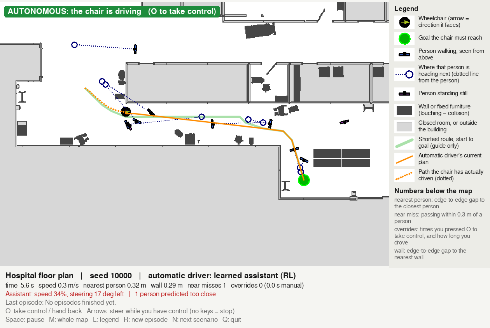

# 2D simulator

The project started here: a 2D simulator for testing **shared control** of a powered wheelchair.
The chair drives itself through crowded rooms and real building floor plans, and the user can take
over at any time. The assistant was first trained here with reinforcement learning, and the 3D
simulator in [webots/](../webots/README.md) runs the same assistant, people and floor plans with
physics, a lidar and a camera.

Built on [SocNavGym](https://github.com/gnns4hri/SocNavGym), a Gymnasium environment of a robot
moving among people.



The 2D code stays at the top of the repository (`envs/`, `assist/`, `training/`, `baselines/`,
`eval/`, `scripts/`), because the 3D simulator imports it. This folder holds its guides:

| Guide | What it covers |
| --- | --- |
| This page | the demo, your own floor plans, measuring, training, using the simulator in code |
| [assistant.md](assistant.md) | the learned assistant: what it sees, how one step works, training, results |
| [socnavgym.md](socnavgym.md) | writing code against the environment: action, observation, reward, scenarios |

## What the 2D simulator covers

| | |
| --- | --- |
| **Working** | 5 generated rooms and 3 real floor plans (hospital, office, warehouse), importing your own floor plan, take-over control with the O key, metrics and repeatable evaluation runs, and a learned assistant (first RL step) that predicts where people are walking and slows down or steers around them in every scenario, with a simple safety stop. It reached the goal in all 400 validation trips across the 8 scenarios without hitting anyone |
| **Simulated** | Pedestrians who walk to their own destinations and make way for the chair (social force model plus our own rules), the chair as a 0.8 m wide circle with real speed limits, the chair's sensors (people and wall positions from the simulator, with noise) and the user's input from a keyboard |
| **Done later, in 3D** | Choosing a named room as the destination (by the directory and signs), voice commands, a safety guard while the rider drives, walkers trained on real pedestrians. Isaac Sim was replaced by Webots, which needs no graphics card. See [webots/README.md](../webots/README.md) |
| **Not built** | Learning from the user's take-overs, a simulated user, DWA and fixed-blending baselines |

Results are from 18 October. Run again on 18 November, after the assistant's rules and the walkers
were changed for the 3D simulator, the assistant reached the goal in 157 of the first 160 validation trips: 3 people were hit,
one in the corridor and two in the hospital ([evals](../docs/evals.md)).

## Quick start

```bash
bash setup.sh                      # once, about 10 minutes
conda activate wheelchair          # or: source .venv/bin/activate
python scripts/demo.py --scenario fp_hospital
```

## Installation

**Requirements**

- macOS or Linux.
- An internet connection during setup. No GPU needed.
- Free disk: about 2 GB on a Mac. On Linux about 8 GB, because pip installs the GPU build of
  PyTorch there even though the project does not use a GPU.
- [Miniconda](https://docs.conda.io/projects/miniconda) (recommended), or Python 3.10 to 3.12 with
  build tools. On Ubuntu or Debian without conda, first run:

  ```bash
  sudo apt update && sudo apt install -y build-essential git python3-venv python3-dev
  ```

- On a Mac, the Xcode Command Line Tools, which `setup.sh` starts installing if they are missing.

**What `bash setup.sh` does**

1. Creates a conda environment called `wheelchair` (Python 3.11), or a `.venv` folder without conda.
2. Downloads and builds SocNavGym and Python-RVO2 at tested versions into `third_party/`.
3. Downloads the hospital, office and warehouse floor plans.
4. Installs `requirements.txt`, and for the 3D simulator Trajectron++ (the learned walkers) and the
   speech model for voice commands (40 MB).
5. Makes `.env` for the course gateway, with the address and model filled in and the key empty.
6. Runs `python scripts/check_install.py`, which should end with "All good".

The output is saved to `setup.log`. It is safe to run again, and you should after pulling changes
to `requirements.txt` or `setup.sh`. Without conda, `PYTHON=python3.12 bash setup.sh` picks a
specific Python.

In every new terminal, activate the environment from the `G19` folder before running anything:
`conda activate wheelchair` (or `source .venv/bin/activate`). The 3D simulator also needs Webots:
see the [main README](../README.md#install).

## Usage

Run every command from the `G19` folder with the environment active. There are five things you
can do:

| Task | Command |
| --- | --- |
| [Watch the chair and take control](#1-watch-the-chair-and-take-control) | `python scripts/demo.py` |
| [Use your own floor plan](#2-use-your-own-floor-plan) | `python scripts/import_floorplan.py` |
| [Measure performance over many runs](#3-measure-performance-over-many-runs) | `python eval/run_episodes.py` |
| [Train the assistant](#4-train-the-assistant) | `python training/train_assist.py` |
| [Use the simulator in your own code](#5-use-the-simulator-in-your-own-code) | `from envs.make_env import make_env` |

### 1. Watch the chair and take control

```bash
python scripts/demo.py --scenario fp_hospital
```

A window opens. The chair drives itself towards the green goal while people walk around it,
each with a dotted line to where they are heading next. The solid green line is the shortest
route from start to goal, the solid orange line is the plan the chair is following now, and the
dotted orange line is the path it has actually driven, so you can compare the two. On floor
plans the view is centred on the chair's start, the goal and the route between them, and moves
when needed to keep the chair in sight (press **M** for the whole building).

The learned assistant drives, in every scenario. When nobody is in the way, the line under the
map says "route clear" and the chair simply follows its route at full speed. When someone is on
the route ahead or predicted to come within 0.3 m of the chair, it shows how the assistant is
reacting, for example "speed 40%, steering 15 deg left" (of the route), and how many people it
predicts will come too close. "SAFETY STOP" means someone is right in front of the chair, or
brushing past its side, so it will not drive forward.

To take control, for example to stop for a drink of water on the way:

1. Press **O** to take control. The badge in the top-left corner turns orange (MANUAL).
2. Steer with the arrow keys: **Up** drives forward, **Left** and **Right** turn, and with no key
   held the chair stops.
3. Press **O** again to hand control back. The badge turns green (AUTONOMOUS) and the chair
   carries on to the same goal from where you left it.

Each time you take control counts as an override. The legend on the right explains every symbol,
and the numbers under the map show the time, the gap to the nearest person, near misses and
overrides.

Other keys: **Space** pause, **M** whole map (floor plans), **L** hide the legend, **R** new
episode, **N** next scenario, **Q** quit.

Options:

| Option | Meaning | Default |
| --- | --- | --- |
| `--scenario NAME` | Which scenario to load (see the table below) | `s1_corridor` |
| `--speed 3` | Play faster than real time | `1` |
| `--seed 10005` | Start from a different scene, and the same seed always gives the same scene | `10000` |
| `--driver rule` | Which automatic driver to use: `auto`, `assist`, `rule`, `route_follower`, `go_to_goal` or `random` (see [assistant.md](assistant.md#results)) | `auto` |

Scenarios:

| Name | What it is |
| --- | --- |
| `s1_corridor` | A long, narrow room (about 22 m by 4.5 m) with 5 to 10 people walking |
| `s2_ward` | A room with tables and chairs, people walking and groups standing |
| `s3_concourse_low`, `_mid`, `_high` | An open hall with 5, 10 or 20 people walking |
| `fp_hospital`, `fp_office`, `fp_warehouse` | Real building floor plans with 8 to 12 people walking near the chair's route |

### 2. Use your own floor plan

1. Get a picture of the floor plan (PNG or JPG) with dark walls on a light background. Crop it to
   the building and erase text and door-swing arcs, or they become walls.
2. Import it, giving the real width of the picture in metres:

   ```bash
   python scripts/import_floorplan.py level2.png --name level2 --width-m 42
   ```

   Check that the printed building size is right. Doors narrower than about 0.9 m are too narrow
   for the chair.
3. Use it like any other scenario:

   ```bash
   python scripts/demo.py --scenario maps/level2.yaml
   ```

### 3. Measure performance over many runs

```bash
python eval/run_episodes.py --scenario fp_hospital --episodes 20
```

This runs 20 episodes without a window and prints the success rate, collisions and near misses.
Each episode is also saved as one row in a file in `data/episodes/`, including the length of the
path driven and of the shortest route. Add `--save-paths` to also save the chair's position at
every step to `data/paths/`, to compare the paths of two drivers or two versions later. `--scenario`
also accepts `rooms`, `floorplans` or `all` to run several scenarios at once. The scenes are the
same every time you run it, so results can be compared fairly.

To compare drivers, run the same command with `--driver assist`, `--driver rule` and
`--driver route_follower`.

### 4. Train the assistant

```bash
python training/train_assist.py
```

This trains the assistant's policy in two stages: it first copies a cautious hand-written rule,
then improves on it with reinforcement learning (PPO), on all eight scenarios. It takes about
45 minutes, with no GPU needed, and saves the result to `models/assist_ppo.zip`, which the demo,
the evaluation and the 3D simulator then use. A trained model is already in Git, so you only need
this after changing the assistant, its reward or how people walk. [assistant.md](assistant.md)
explains what the assistant sees and does, the reward, and its results.

### 5. Use the simulator in your own code

```python
from envs.make_env import make_env

env = make_env("s3_concourse_mid")        # any scenario name from the table above
obs, info = env.reset(seed=10_000)        # the same seed gives the same scene
done = False
while not done:
    action = [0.5, 0.0, 0.2]              # [forward, sideways (ignored), turn], each -1 to 1
    obs, reward, terminated, truncated, info = env.step(action)
    done = terminated or truncated
print("success" if info["SUCCESS"] else "collision" if info["COLLISION"] else "timeout")
```

Always create environments with `make_env`, which applies our fixes to SocNavGym.
[socnavgym.md](socnavgym.md) explains what the observation, action, reward and `info` contain, how
to change or add scenarios, and how to train with Stable-Baselines3.

## The 2D code

```
envs/        environments: make_env.py, floor plans, how people walk, SocNavGym fixes, scenario configs
assist/      the learned assistant: people tracker, wall sensor, controller, driver
training/    the assistant's training environment and PPO training script
baselines/   automatic drivers (go_to_goal.py, route_follower.py)
eval/        metrics, evaluation runs, comfort measures and comparing two runs
scripts/     setup check, demo, floor-plan import and download, SiT track tools
models/      assist_ppo.zip, the trained assistant
maps/        your own floor plans
```
