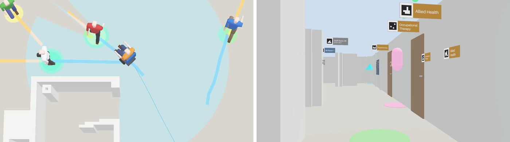

# G19: Shared-control wheelchair

A powered wheelchair that drives itself through a building it does not know, gives way to the people
around it, and hands control back the moment its rider asks. The rider says where to go, by voice,
by keys or by looking at a place, and can take over at any time. Everything runs in simulation, in
Webots, for COMP3110 at UNSW.



## What it does

| Feature | Try it | Details |
| --- | --- | --- |
| Drives itself to a goal among people, with a policy trained by reinforcement learning in 2D and run unchanged in 3D | `python webots/run.py fp_hospital` | [webots/README.md](webots/README.md) |
| Keeps going when people are in the way: asks walkers to step aside, goes round, waits for people crossing | always on | [Keeping going](webots/README.md#keeping-going-ask-walkers-go-round-or-wait) |
| The rider takes over (**O**) and hands back, and while they drive the chair still slows and stops for people and walls ahead | press **O** | [When the rider drives](webots/README.md#when-the-rider-drives) |
| Finds a named room without the floor plan, by reading the directory and following the signs | add `--open-world` | [docs/webots_open_world.md](docs/webots_open_world.md) |
| Voice commands: "stop", "go to Pharmacy", or the rider's own words ("I need my prescription") through a language model | hold **K** and speak | [docs/voice.md](docs/voice.md) |
| Picks a place by looking at it: wall markers and a red aiming line | add `--landmarks` | [docs/markers.md](docs/markers.md) |
| People who walk like real ones: learned walkers trained on recordings, predicted and recorded tracks | add `--walkers learned` or `--tracks` | [docs/people.md](docs/people.md) |
| Testers walk round the chair from their phones | add `--phones` | [Phones](webots/README.md#phones) |
| Personal space zones round the chair (proxemics), measured on every trip and drawn on the floor | add `--zones` or press **Z** | [docs/proxemics.md](docs/proxemics.md) |

## Install

macOS or Linux, with an internet connection and no graphics card needed. From the `G19` folder:

```bash
bash setup.sh                                  # the Python environment, libraries and speech model, once
bash webots/install_webots.sh                  # Webots, once
conda activate wheelchair                      # in every new terminal
python webots/make_world.py all --variants 3   # build the worlds, about 1 to 2 minutes
python webots/run.py fp_hospital --open-world  # G goes to the directory, hold K to speak
```

What `setup.sh` does and what it needs is in the [2D guide](2d-simulator/README.md#installation). Voice
commands in the rider's own words also need a course gateway key in `G19/.env`
([voice](webots/README.md#voice-commands)).

## Results

| Test | Result |
| --- | --- |
| Latest model (20 Nov): fine-tuned with walkers trained on real people (SiT) and the proxemic reward, on the 540 validation trips with those walkers | 539 reached the goal (99.8%), 0 collisions, 1 timeout, 10.3 hard brakes a trip. The cautious hand-written rule on the same trips: 536, 0 collisions, 15.5 hard brakes a trip |
| Held-back test, run once (18 Nov): the first model on 540 trips in buildings and furniture never trained on, three kinds of crowd | 536 reached the goal (99.3%), 1 collision. A driver that ignores people: 229 (42%), 311 collisions. The cautious rule: 537, 0 collisions, with 44% more hard braking |
| The rider drives at a wall and holds forward, 10 trips | stopped 0.06 to 0.11 m short every time, touched the wall in 5 of 8 without the brake |
| The rider drives at the nearest person, 4 take-overs | 0 people hit with the brake, 3 without |
| Finding a named room without the floor plan, 10 hospital trips | 10 of 10 reached |
| The rider's own words to a command, 114 test requests | 92% right, no wrong moves |

To drive with the latest model: `python webots/run.py fp_hospital --model models/sit_prox.zip --walkers learned`.
Every test, how to run it again and what it ran on: [docs/evals.md](docs/evals.md). Where the data comes
from and how it is split: [docs/data.md](docs/data.md).

## Documentation

| Page | Read it for |
| --- | --- |
| [webots/README.md](webots/README.md) | the 3D simulator: every option and key, and each feature in short |
| [docs/evals.md](docs/evals.md) | every test, the command to run it again, and its result |
| [docs/data.md](docs/data.md) | where the data comes from, licences, the train and test split, what is kept in Git |
| [docs/proxemics.md](docs/proxemics.md) | the personal space zones: where the idea came from, design, results, references |
| [docs/webots_results.md](docs/webots_results.md) | the rules that keep the chair going, and their results |
| [docs/webots_open_world.md](docs/webots_open_world.md) | finding rooms by the directory and signs: how it works, results |
| [docs/voice.md](docs/voice.md) | voice commands: how they are recognised, choosing the model, results |
| [docs/markers.md](docs/markers.md) | pointing and markers |
| [docs/people.md](docs/people.md) | the crowd, the events, predicted and recorded tracks (SiT) |
| [webots/walk_model/README.md](webots/walk_model/README.md) | learned walkers: Trajectron++ trained on real people |
| [docs/evaluation.md](docs/evaluation.md) | the comfort measures: stops, braking, speed near people |
| [docs/webots_training.md](docs/webots_training.md) | fine-tuning the policy in Webots |
| [docs/aws_training.md](docs/aws_training.md) | training and testing on the AWS machines |
| [2d-simulator/README.md](2d-simulator/README.md) | the 2D simulator the project started with, and the first trained assistant |
| [maps/README.md](maps/README.md) | your own floor plans |

## Built with

| Part | Used for | References |
| --- | --- | --- |
| [Webots](https://cyberbotics.com) R2025a | the 3D simulator | [webots_training.md](docs/webots_training.md#references) |
| [SocNavGym](https://github.com/gnns4hri/SocNavGym), Gymnasium, Python-RVO2 | the 2D simulator | [socnavgym.md](2d-simulator/socnavgym.md#references) |
| Stable-Baselines3 (PPO), PyTorch | training the assistant | [assistant.md](2d-simulator/assistant.md#references) |
| Trajectron++, SiT, ETH/UCY | the learned walkers | [walk_model](webots/walk_model/README.md#references), [data.md](docs/data.md#references) |
| OpenCV (ArUco), RapidOCR, Ultralytics YOLO11 | reading signs in the open world | [webots_open_world.md](docs/webots_open_world.md#references) |
| Vosk, gpt-oss-120b on the course gateway, espeak-ng, sounddevice | voice commands | [voice.md](docs/voice.md#references) |
| Hall's proxemic zones | personal space round the chair | [proxemics.md](docs/proxemics.md#references) |

The Python libraries and their versions are in `requirements.txt`, which `setup.sh` installs. The sign
detector also needs `pip install ultralytics` (AGPL-3.0).

## Folders

```
webots/        the 3D simulator: worlds, the bridge to the 2D code, run.py, open world, voice, their test scripts
assist/        the assistant: people tracker, wall sensor, controller with the keeping-going rules
baselines/     drivers without learning (route follower, go to goal)
training/      the 2D training environment and PPO training
envs/          floor plans, how people walk, SocNavGym fixes, scenario configs
eval/          metrics, comfort measures, comparing two runs
scripts/       setup check, the 2D demo, floor-plan import, SiT tools
models/        the trained policies and the walk model
maps/          your own floor plans
data/          results and traces made by runs (not in Git)
tests/         unit tests (python -m pytest)
results/       the results quoted in the docs
docs/          the guides above
2d-simulator/  the 2D simulator's guides
```
